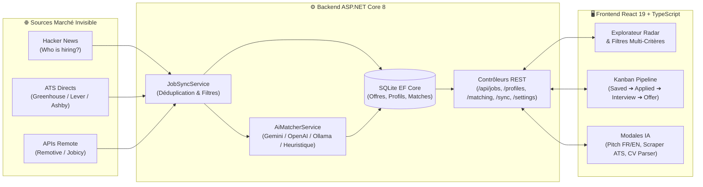

# 🎯 HiddenJobs Hunter — Radar du Marché Invisible & Matching IA Full Remote

[](./LICENSE)
[](https://dotnet.microsoft.com/)
[](https://react.dev/)
[](https://www.typescriptlang.org/)
[](./sonar-project.properties)

**HiddenJobs Hunter** est une plateforme web locale de détection d'opportunités d'emploi issues du **« marché invisible »** et du **Full Remote international**, conçue pour les ingénieurs logiciels (profils Fullstack .NET / React, Backend, Frontend, DevOps, Cloud). Elle combine l'agrégation directe sans intermédiaire (Hacker News *Who is hiring?*, ATS d'entreprises, APIs Remote) avec un moteur de **Matching IA hybride (LLM Cloud/Local + Heuristique hors-ligne)** évaluant la compatibilité technique ainsi que la **faisabilité administrative depuis la France** (CDI, Portage/EOR, Freelance B2B).

---

## ✨ Fonctionnalités Clés

- **📡 Radar du Marché Invisible (Zéro Intermédiaire)** :
  - **Hacker News « Ask HN: Who is hiring? »** : Extraction mensuelle des offres publiées directement par les **CTOs, fondateurs et VP Engineering**, avec détection automatique des emails de contact direct et contournement des filtres ATS classiques.
  - **Connecteurs & Scraper d'ATS Directs (`CustomAtsProvider`)** : Aspiration à la volée des boards **Greenhouse**, **Lever**, **Ashby** et des pages carrières HTML génériques à partir d'une simple URL.
  - **APIs Remote Internationales (`Remotive`, `Jobicy`)** : Flux d'ingénierie logicielle 100 % télétravail filtrés par zone géographique (*Worldwide*, *Europe / CET*, *US-Only*).
- **🧠 Matching IA & Faisabilité Administrative depuis la France (`AiMatcherService`)** :
  - Calcul du **Score Global de Match (0–100 %)** combinant l'adéquation de la stack technique (`TechStackFit`) et l'éligibilité géographique (`RemoteEligibilityFit`).
  - **Analyse de faisabilité légale/contractuelle depuis la France** : Identifie si le poste est accessible en **CDI** (entité locale), via **EOR / Portage salarial** (*Deel, Remote.com, Oyster*) ou en **contrat Freelance / Contractor B2B** (facturation directe internationale sans contrainte de visa).
  - Identification automatique des **points forts** et des **points de vigilance / compétences manquantes**.
- **✉️ Générateur de Pitch d'Approche Directe (FR / EN)** :
  - Rédaction de messages de *cold outreach* personnalisés et concis (en français ou en anglais selon la langue de l'annonce) prêts à être envoyés directement au CTO ou recruteur.
- **👥 Gestion Multi-Profils & Analyseur de CV IA** :
  - Création et bascule instantanée entre plusieurs profils (ex. *Fullstack .NET / React*, *Backend Go / Rust*, *DevOps Cloud*).
  - Extraction automatique d'un CV brut (`POST /api/profiles/parse-resume`) renseignant le titre, les années d'expérience, les compétences clés/secondaires et les langues.
- **🔌 Architecture IA Hybride (100 % Hors-Ligne par défaut)** :
  - Fonctionne **immédiatement sans aucune clé API** grâce au moteur algorithmique heuristique local.
  - Supporte **Google Gemini** (`gemini-2.5-flash`), **OpenAI** (`gpt-4o-mini`) et **Ollama** (modèles locaux `llama3`, `mistral`) avec basculement automatique (*fallback*) sur le moteur heuristique en cas d'indisponibilité réseau.

---

## 🏗️ Architecture Système



---

## 🚀 Installation & Démarrage Rapide

### Prérequis
- **.NET SDK** `>= 8.0`
- **Node.js** `>= 22.0.0` & **npm** `>= 10.0.0`

### 1. Cloner et installer
```bash
git clone https://github.com/IAlexy/hidden-jobs-hunter.git
cd hidden-jobs-hunter

# Installer les dépendances du frontend
cd frontend && npm install && cd ..

# Restaurer la solution .NET 8
dotnet restore HiddenJobsHunter.sln
```

### 2. Configuration (Optionnelle)
Par défaut, l'application utilise le moteur **Heuristique Local** (aucune clé API requise) et crée automatiquement sa base SQLite locale. Vous pouvez copier `.env.example` ou configurer vos clés **Google Gemini / OpenAI / Ollama** directement depuis l'interface graphique (**⚙️ Paramètres**) :
```bash
cp .env.example .env
```

### 3. Lancer l'application

**Option A — Script tout-en-un (Linux / macOS / WSL) :**
```bash
./start.sh
# ou via le menu interactif :
./launcher.sh
```

**Option B — Lancement en deux terminaux (depuis la racine) :**
```bash
# Terminal 1 : Backend API ASP.NET Core 8 (http://localhost:5000)
npm run dev:backend

# Terminal 2 : Frontend React 19 + Vite (http://localhost:5173)
npm run dev:frontend
```
Puis ouvrez `http://localhost:5173` dans votre navigateur (documentation Swagger disponible sur `http://localhost:5000/swagger`).

---

## 🧪 Tests Automatisés & Qualité Sonar

Le projet intègre une suite complète de tests côté Backend (**xUnit** + **WebApplicationFactory** + **SQLite in-memory/isolé**) et côté Frontend (**Vitest** + **React Testing Library** + **JSDOM**), ainsi qu'une analyse statique stricte (**SonarAnalyzer.CSharp** + **Oxlint** avec **0 warning**).

```bash
# Lancer l'ensemble des tests (Backend xUnit + Frontend Vitest)
npm test

# Lancer uniquement les tests Backend (.NET 8 : AiMatcher, Providers, JobSync, API Integration)
npm run test:backend

# Lancer les tests Backend avec rapport de couverture OpenCover
npm run test:backend:coverage

# Lancer uniquement les tests Frontend (Vitest : Client API + Composants UI React)
npm run test:frontend

# Lancer les tests Frontend avec rapport de couverture LCOV
npm run test:frontend:coverage

# Vérifier l'analyse statique Sonar C#, Oxlint et le typage TypeScript strict (0 warning)
npm run lint

# Compiler l'ensemble du projet (Solution .NET 8 + Bundle de production React/Vite)
npm run build
```

---

## 📡 Référence de l'API REST (`http://localhost:5000`)

### Offres d'emploi (`/api/jobs`)

| Méthode | Route | Description |
| :--- | :--- | :--- |
| `GET` | `/api/jobs` | Liste paginée et triée par score de match (`search`, `source`, `remoteScope`, `contractType`, `status`, `minScore`, `remoteOnly`, `franceCompatibleOnly`, `profileId`, `page`, `pageSize`). |
| `GET` | `/api/jobs/{id}` | Détail complet d'une offre et de son analyse de matching active. |
| `PATCH` | `/api/jobs/{id}/status` | Met à jour le statut Kanban (`Discovered`, `Saved`, `Applied`, `Interview`, `Offer`, `Archived`, `Rejected`) et les notes. |
| `PATCH` | `/api/jobs/{id}/notes` | Met à jour les notes personnelles associées à une offre. |
| `GET` | `/api/jobs/stats` | Statistiques globales du radar et du pipeline de candidatures. |
| `DELETE` | `/api/jobs/{id}` | Supprime une offre spécifique. |
| `DELETE` | `/api/jobs/clear` | Purge toutes les offres de la base de données. |

### Profils & CV (`/api/profiles`)

| Méthode | Route | Description |
| :--- | :--- | :--- |
| `GET` | `/api/profiles` | Liste tous les profils utilisateurs avec leurs compteurs de matchs. |
| `GET` | `/api/profiles/active` | Récupère le profil utilisateur actuellement actif. |
| `GET` | `/api/profiles/{id}` | Récupère les détails complets d'un profil. |
| `POST` | `/api/profiles` | Crée un nouveau profil candidat. |
| `PUT` | `/api/profiles/{id}` | Met à jour un profil existant. |
| `POST` | `/api/profiles/{id}/activate` | Définit le profil spécifié comme profil actif. |
| `POST` | `/api/profiles/parse-resume` | Analyse un texte de CV brut (via IA ou heuristique) et extrait les compétences, l'expérience, le titre et les langues (alias `/api/profiles/parse-cv`). |
| `DELETE` | `/api/profiles/{id}` | Supprime un profil (protégé contre la suppression du dernier profil restant). |

### Matching IA & Pitchs (`/api/matching`)

| Méthode | Route | Description |
| :--- | :--- | :--- |
| `POST` | `/api/matching/job/{id}` | Calcule ou recalcule le score de matching et l'analyse pour une offre donnée. |
| `POST` | `/api/matching/match-all` | Lance le matching en lot sur les offres non encore évaluées (alias `/api/matching/batch`). |
| `POST` | `/api/matching/job/{id}/pitch` | Génère un pitch d'approche directe sur-mesure (FR/EN) pour une offre (alias `POST /api/matching/pitch`). |

### Synchronisation & Scraping ATS (`/api/sync`)

| Méthode | Route | Description |
| :--- | :--- | :--- |
| `GET` | `/api/sync/providers` | Liste les connecteurs d'offres configurés (`HackerNews`, `Remotive`, `Jobicy`, `CustomAts`). |
| `POST` | `/api/sync` | Déclenche la synchronisation de tous les fournisseurs, la déduplication et l'auto-matching. |
| `POST` | `/api/sync/ingest-url` | Scrape et importe directement les offres depuis une URL carrière Greenhouse, Lever, Ashby ou HTML générique. |

### Paramètres & Fournisseurs IA (`/api/settings`)

| Méthode | Route | Description |
| :--- | :--- | :--- |
| `GET` | `/api/settings` | Récupère la configuration active avec masquage de sécurité (`********`) des clés API. |
| `PUT` | `/api/settings` | Met à jour le fournisseur IA (`Heuristic`, `Gemini`, `OpenAI`, `Ollama`) et préserve les clés masquées. |
| `POST` | `/api/settings/test-ai` | Teste la connectivité avec le fournisseur IA sélectionné. |

---

## 📁 Structure du Projet

```text
hidden-jobs-hunter/
├── .github/workflows/
│   └── ci.yml                              # Pipeline CI/CD GitHub Actions (.NET 8, React 19, Sonar)
├── backend/
│   ├── Controllers/                        # Contrôleurs REST (Jobs, Profiles, Matching, Sync, Settings)
│   ├── Data/
│   │   └── AppDbContext.cs                 # Contexte EF Core SQLite & Seed du profil de démo
│   ├── Models/                             # Entités (JobOffer, JobMatch, UserProfile, AppSettings)
│   ├── Providers/                          # Connecteurs (HackerNews, Remotive, Jobicy, CustomAts)
│   ├── Services/                           # AiMatcherService & JobSyncService
│   ├── HiddenJobsHunter.Tests/             # Suite de tests xUnit (Unitaires + Intégration WebApplicationFactory)
│   │   ├── AiMatcherServiceTests.cs
│   │   ├── ProvidersAndSyncTests.cs
│   │   └── ApiControllersIntegrationTests.cs
│   ├── HiddenJobsHunter.Api.csproj
│   └── Program.cs                          # Point d'entrée ASP.NET Core 8
├── frontend/
│   ├── src/
│   │   ├── components/                     # Composants UI (Header, JobCard, KanbanView, Modales...)
│   │   ├── api.ts                          # Client HTTP REST typé
│   │   ├── types.ts                        # Interfaces TypeScript partagées
│   │   └── App.tsx                         # Contrôleur principal React 19
│   ├── tests/
│   │   ├── unit/api.test.ts                # Tests unitaires Vitest du client API
│   │   └── ui/components.test.tsx          # Tests d'interface React Testing Library
│   ├── package.json
│   ├── vite.config.ts
│   └── vitest.config.ts
├── scripts/                                # Scripts de gestion des services (start, stop, status, launcher)
├── Directory.Build.props                   # Configuration globale MSBuild & SonarAnalyzer.CSharp
├── HiddenJobsHunter.sln                    # Solution .NET 8
├── sonar-project.properties                # Configuration SonarQube / SonarCloud
├── CONTRIBUTING.md                         # Guide de contribution
├── LICENSE                                 # Licence MIT
└── README.md                               # Documentation principale
```

---

## 📄 Licence

Distribué sous licence **MIT**. Voir le fichier [LICENSE](./LICENSE) pour plus d'informations.
